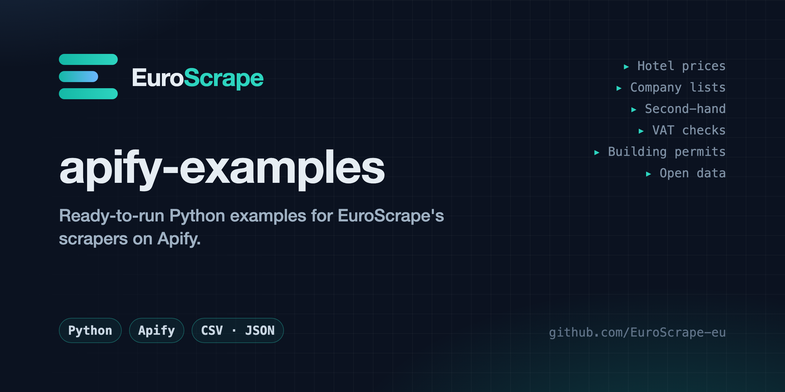

# EuroScrape Apify examples



Small, ready-to-run Python scripts built on [EuroScrape Actors](https://apify.com/euroscrape?fpr=53ztcw) on Apify. Each one runs an Actor, turns its output into something useful and writes a CSV.

| Example | Actor | What it does |
|---|---|---|
| [flight-fare-calendar](flight-fare-calendar/fare_calendar.py) | [Google Flights Scraper](https://apify.com/euroscrape/google-flights-prices?fpr=53ztcw) | Cheapest day to fly on one or more routes, as a calendar |
| [hotel-rate-parity-monitor](hotel-rate-parity-monitor/parity.py) | [Google Hotels Scraper](https://apify.com/euroscrape/google-hotels-prices?fpr=53ztcw) | Is the hotel's own website the cheapest place to book it? |
| [eu-tenders-slack-alerts](eu-tenders-slack-alerts/tenders.py) | [EU Public Tenders Scraper](https://apify.com/euroscrape/eu-public-tenders?fpr=53ztcw) | New public tenders matching your keywords, posted to Slack |
| [french-companies-clay-sheets](french-companies-clay-sheets/README.md) | [French Companies](https://apify.com/euroscrape/france-companies?fpr=53ztcw) | Enrich SIREN numbers from Clay or Google Sheets: directors, revenue, VAT (first 50 companies free) |
| [bodacc-supplier-check](bodacc-supplier-check/README.md) | [BODACC Scraper](https://apify.com/euroscrape/bodacc-scraper?fpr=53ztcw) | Check a list of French suppliers (SIREN) against insolvency notices in the official journal (first 10 notices of each run free) |
| [boamp-tender-digest](boamp-tender-digest/README.md) | [BOAMP Scraper](https://apify.com/euroscrape/boamp-scraper?fpr=53ztcw) | Open French public tenders matching your keywords and departments, sorted by deadline, as a daily CSV (first 10 tenders of each run free) |
| [finess-health-establishments](finess-health-establishments/README.md) | [FINESS Scraper](https://apify.com/euroscrape/finess-scraper?fpr=53ztcw) | French nursing homes, clinics and laboratories by department, with new openings, as a CSV (first 10 establishments of each run free) |
| [shop-complaint-rate](shop-complaint-rate/complaints.py) | [Trusted Shops Scraper](https://apify.com/euroscrape/trusted-shops-scraper?fpr=53ztcw) | Online shops of a niche ranked by their share of unhappy customers |

## Run one

```bash
pip install apify-client requests
export APIFY_TOKEN=your_token   # https://console.apify.com/settings/integrations
python flight-fare-calendar/fare_calendar.py LIS-AMS MAD-ROM --days 30 --nonstop
```

Usage for each script is in its docstring. Runs are billed to your own Apify account.

More: [euroscrape.com](https://euroscrape.com/) · [all Actors](https://apify.com/euroscrape?fpr=53ztcw) · [MCP server for AI agents](https://github.com/EuroScrape-eu/euroscrape-mcp)

## License

MIT

## Comparison guides

Honest comparisons of the tools for a few common jobs, with prices and public success rates read on the Apify Store (EuroScrape included, and said so when it is not the best fit):

- [Best Vinted Scraper 2026: 5 Options Compared](guides/best-vinted-scraper.md)
- [Best Kleinanzeigen Scraper 2026: 5 Options Compared](guides/best-kleinanzeigen-scraper.md)
- [Best Tool to Find Local Businesses Without a Website (2026)](guides/best-tool-businesses-without-website.md)
- [Best French Company Data API 2026 (SIRENE, NAF Code)](guides/best-french-company-data-api.md)
- [Alternative à l'API Pappers : liste d'entreprises par code NAF](guides/alternative-api-pappers.md)

## Free open datasets

Counts built from official registers, as CSV, each with a notebook (no personal data). All of them: [Hugging Face collection](https://huggingface.co/collections/EuroScrape/company-and-market-signals-europe-and-us-6afc8ee1691da3dc0d5f00b0) · [Kaggle](https://www.kaggle.com/euroscrape/datasets).

- [US startup raises by state (SEC Form D, 30 days)](https://huggingface.co/datasets/EuroScrape/us-startup-funding-by-state-2026-11) · [notebook](https://www.kaggle.com/code/euroscrape/where-us-startups-raised-money-this-month)
- [US new business filings per month (New York, Colorado, Connecticut)](https://huggingface.co/datasets/EuroScrape/us-new-business-filings-monthly-2024-2026) · [notebook](https://www.kaggle.com/code/euroscrape/us-new-business-filings-month-by-month)
- [US building permits in six cities by type (30 days)](https://huggingface.co/datasets/EuroScrape/us-building-permits-six-cities-2026-11)
- [French company signals by département and day (creations, insolvencies, contract awards)](https://huggingface.co/datasets/EuroScrape/france-company-signals-daily-2026-11) · [notebook](https://www.kaggle.com/code/euroscrape/french-companies-start-fail-and-win-contracts)

<sub>Links to apify.com carry EuroScrape's Apify affiliate code: if you take a paid Apify plan, Apify may pay EuroScrape a commission, at no cost to you.</sub>
